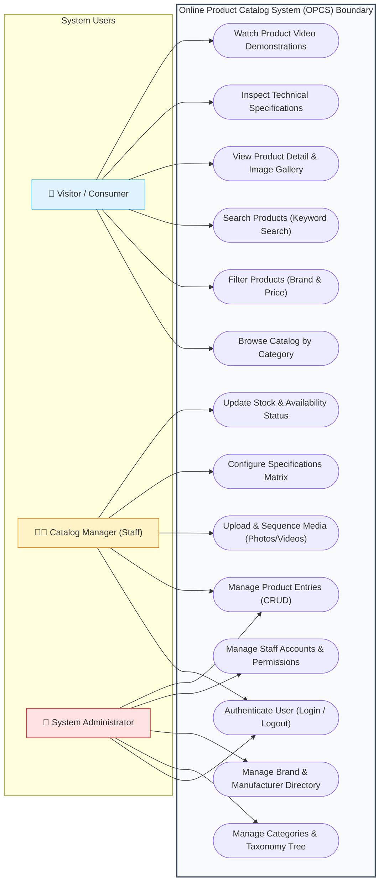
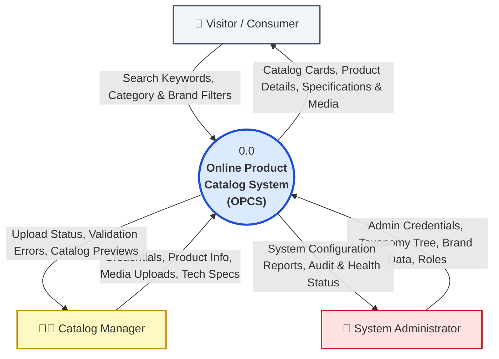
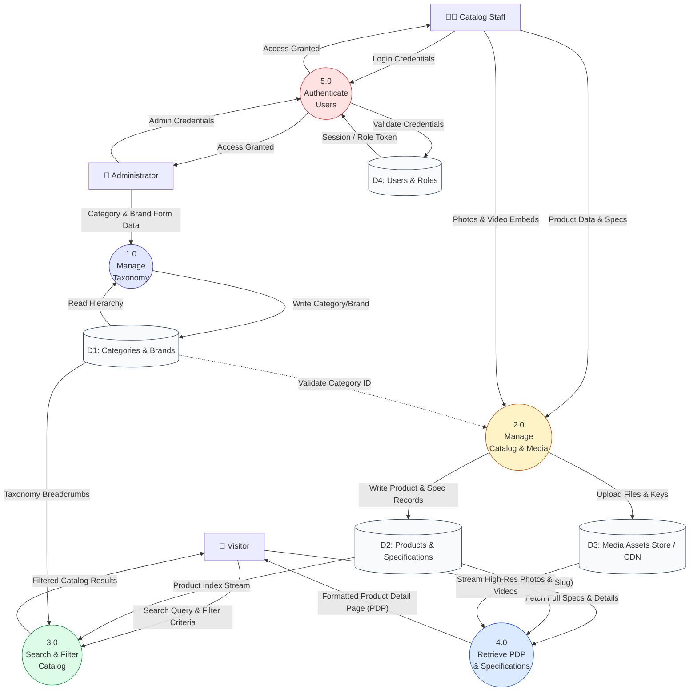
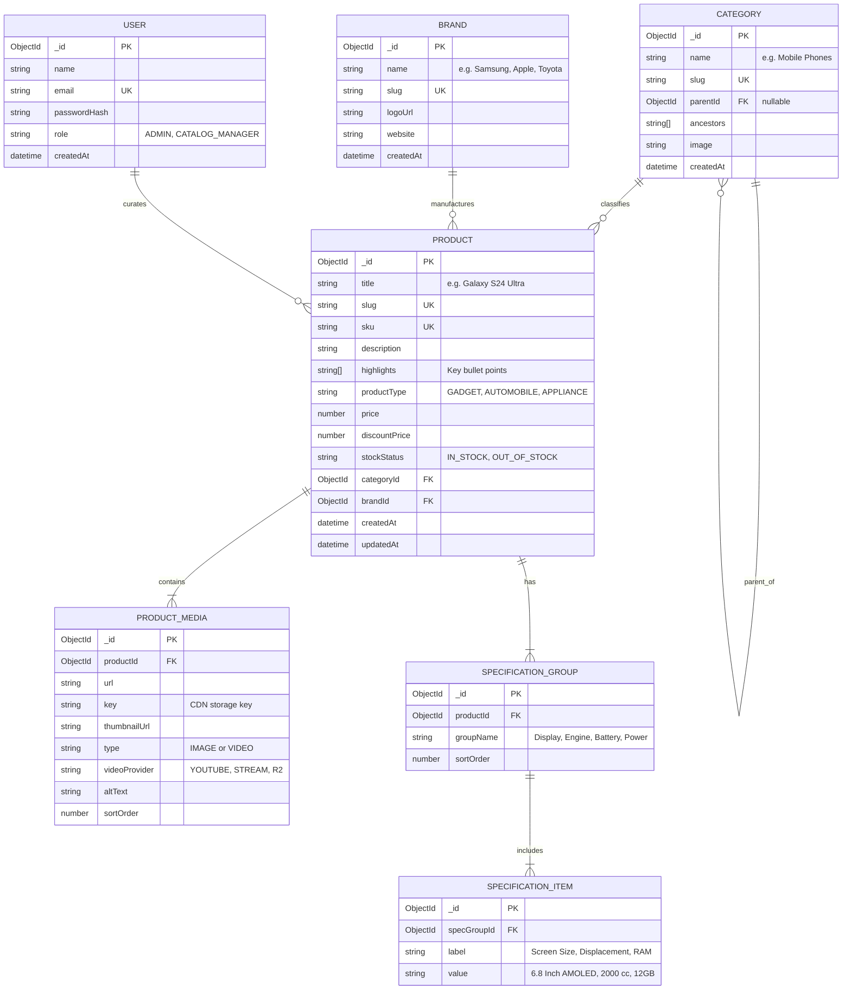
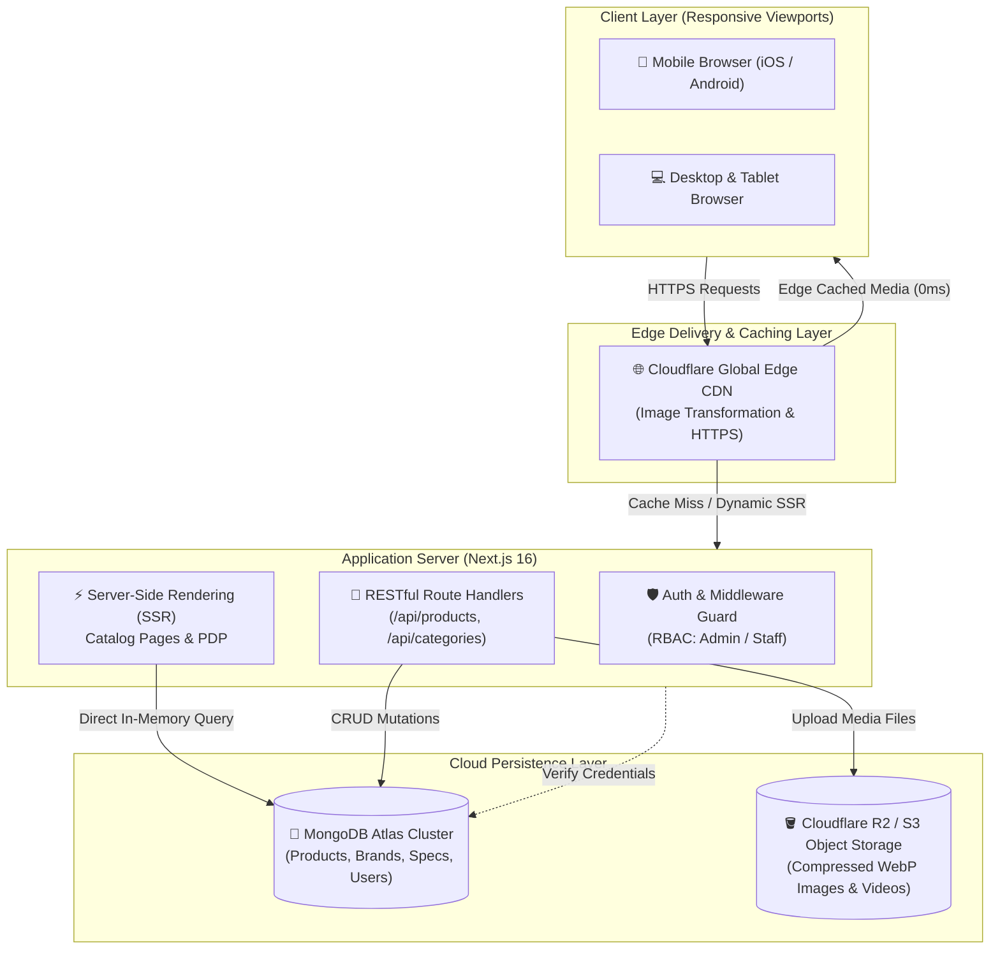

# 🎨 Complete Diagrams Guide, Mermaid Codes & Generation Prompts
**Project:** Online Product Catalog System (OPCS)  
**Target Document:** `Online-Product-Catalog-System-SRS.docx` / `Online-Product-Catalog-System-SRS.md`  
**Standard:** IEEE 830-1998 Software Requirements Specification

---

## 📌 Document Insertion Map (কোন ডায়াগ্রাম কোথায় বসবে?)

| Diagram Name | Report Section | Exact Location in Document | Figure Number & Recommended Caption |
| :--- | :--- | :--- | :--- |
| **Use Case Diagram** | **Section 2.3** *(User Classes and Characteristics)* | ঠিক User Classes টেবিলের নিচে, Section 2.4-এর আগে। | **Figure 2.1:** Use Case Diagram for Online Product Catalog System |
| **DFD Level-0** *(Context Diagram)* | **Section 6.2** *(Data Flow Diagram)* | Section 6.2-এর Level-0 বর্ণনার ঠিক নিচে। | **Figure 6.2(a):** Level-0 Context Data Flow Diagram |
| **DFD Level-1** *(Process Breakdown)* | **Section 6.2** *(Data Flow Diagram)* | Section 6.2-এর Level-1 বর্ণনার ঠিক নিচে। | **Figure 6.2(b):** Level-1 Detailed Data Flow Diagram |
| **Entity-Relationship Diagram (ERD)** | **Section 6.1** *(Data Model)* | Section 6.1-এর Entity তালিকা ও বর্ণনার নিচে। | **Figure 6.1:** Entity-Relationship Diagram (ERD) |
| **System Architecture Diagram** *(Bonus)* | **Section 2.1** *(Product Perspective)* | Section 2.1-এর প্যারাগ্রাফের ঠিক নিচে। | **Figure 2.0:** High-Level Cloud & Storage Architecture |

---

## 🛠️ ডায়াগ্রাম তৈরির সেরা পদ্ধতি (Step-by-Step Instructions)

### পদ্ধতি ১: Draw.io ব্যবহার করে (সবচেয়ে নিখুঁত, প্রফেশনাল ও একাডেমিক স্ট্যান্ডার্ড)
> **কেন এটি সেরা:** কোনো টেক্সট ঝাপসা হবে না, অ্যারো বা বক্স ভাঙবে না, এবং শিক্ষক ১০০% ফুল মার্কস দেবেন।

1. আপনার ব্রাউজারে **[draw.io](https://app.diagrams.net)** (অথবা diagrams.net) ওপেন করুন।
2. **"Create New Diagram"** ➔ **"Blank Diagram"** সিলেক্ট করুন।
3. উপরের মেনু বার থেকে ক্লিক করুন:  
   👉 **Arrange** ➔ **Insert** ➔ **Advanced** ➔ **Mermaid**
4. নিচের সেকশন থেকে সংশ্লিষ্ট ডায়াগ্রামের **Mermaid Code** কপি করে বক্সের ভেতর পেস্ট করুন এবং **Insert** বাটনে চাপ দিন।
5. সাথে সাথে সম্পূর্ণ ডায়াগ্রাম ড্র হয়ে যাবে! চাইলে কালার বা বক্সের সাইজ সামান্য ড্র্যাগ করে অ্যাডজাস্ট করতে পারেন।
6. এরপর মেনু থেকে: **File ➔ Export as ➔ PNG** (অথবা JPEG), DPI দিন `300` (প্রিন্টের জন্য ক্রিস্প কোয়ালিটি) এবং সেভ করুন।

---

### পদ্ধতি ২: Google Gemini Pro / AI Image Generator দিয়ে (Conceptual Visual Rendering)
> **সতর্কতা:** AI ইমেজ জেনারেটরে দেওয়ার জন্য এমন প্রম্পট দেওয়া হয়েছে যা ক্লিন ভেক্টর স্টাইল বজায় রাখবে।

---

## 1. Use Case Diagram

### 📍 বসবে: Section 2.3 (User Classes and Characteristics)

#### A. Draw.io Mermaid Code (সরাসরি পেস্ট করার জন্য):

#### B. Gemini Pro / AI Image Prompt (যদি AI জেনারেটর দিয়ে ছবি বানাতে চান):
> *"A professional UML Use Case Diagram for an 'Online Product Catalog System' on a clean white background. Shows three distinct human actors on the left: 'Visitor', 'Catalog Manager', and 'System Administrator'. In the center is a neat rectangular system boundary containing clear oval use cases: 'Browse Catalog', 'Search Products', 'Inspect Specifications', 'View Multimedia Gallery', 'Manage Products & Media', 'Manage Categories & Brands', and 'Authenticate User'. Clean solid association lines connecting actors to use cases. Technical software engineering drawing style, ultra-high resolution, black and white with subtle slate blue accents, crisp legible English typography."*

---

## 2. Data Flow Diagram (DFD) — Level 0 (Context Diagram)

### 📍 বসবে: Section 6.2 (Data Flow Diagram - Level 0)

#### A. Draw.io Mermaid Code:

#### B. Gemini Pro / AI Image Prompt:
> *"A Level-0 Context Data Flow Diagram (DFD) for an Online Product Catalog System. In the center is a large circle labeled '0.0 Online Product Catalog System'. Three external entities represented as sharp rectangles around it: 'Visitor' at the bottom, 'Catalog Manager' at top-left, and 'System Administrator' at top-right. Labeled directed arrows showing data flow: 'Search Keywords & Filters' flowing inward, 'Product Details, Specifications & Media' flowing outward to Visitor; 'Product Entries & Media Uploads' flowing inward from Staff; 'Taxonomy & System Config' flowing from Admin. Academic software engineering chart, clean white background, vector diagram."*

---

## 3. Data Flow Diagram (DFD) — Level 1 (Process Decomposition)

### 📍 বসবে: Section 6.2 (Data Flow Diagram - Level 1)

#### A. Draw.io Mermaid Code:

---

## 4. Entity-Relationship Diagram (ERD)

### 📍 বসবে: Section 6.1 (Data Model)

#### A. Draw.io Mermaid Code:

#### B. Gemini Pro / AI Image Prompt:
> *"A professional Crow's Foot Entity Relationship Diagram (ERD) for an Online Product Catalog System. Displays relational boxes: 'CATEGORY', 'BRAND', 'PRODUCT', 'PRODUCT_MEDIA', 'SPECIFICATION_GROUP', and 'USER'. Clean relational connectors showing 1-to-many relationships (e.g., One BRAND has many PRODUCTS; One PRODUCT has many PRODUCT_MEDIA; One PRODUCT has many SPECIFICATION_GROUPs). Primary keys (PK) and Foreign keys (FK) clearly indicated. Clean database design schema layout, white background, crisp technical typography."*

---

## 5. System Architecture & Cloud Infrastructure Diagram *(Optional Bonus)*

### 📍 বসবে: Section 2.1 (Product Perspective)

#### A. Draw.io Mermaid Code:

---

## 💡 শিক্ষককে দেখানোর সময় শেষ চেকলিস্ট (Teacher Defense Tips)
1. **ক্যাটালগের মাল্টিমিডিয়া সাপোর্ট:** শিক্ষক যদি জিজ্ঞেস করেন *"হোম অ্যাপ্লায়েন্স বা মোবাইল ফোনের স্পেসিফিকেশন কীভাবে ম্যানেজ করেছেন?"*  
   👉 বলবেন: *`SPECIFICATION_GROUP` এবং `SPECIFICATION_ITEM` ডাইনামিক স্কিমার মাধ্যমে যেকোনো ক্যাটাগরির জন্য আলাদা স্পেক্স টেবিল তৈরি করা যায় (যেমন: ফোনের জন্য RAM/Processor, গাড়ির জন্য Engine/Horsepower)।*
2. **স্কোপ বাউন্ডারি:** শিক্ষক যদি জিজ্ঞেস করেন *"পেমেন্ট বা কার্ট অপশন কোথায়?"*  
   👉 বলবেন: *সমস্যা নং ৪ ছিল স্পেসিফিকভাবে "Online Product Catalog System"। তাই IEEE 830 স্ট্যান্ডার্ড অনুযায়ী অপ্রয়োজনীয় পেমেন্ট/কুরিয়ার কমপ্লেক্সিটি বাদ দিয়ে পিওর হাই-পারফরম্যান্স ক্যাটালগ এবং স্পেসিফিকেশন ইঞ্জিন তৈরি করা হয়েছে।*
